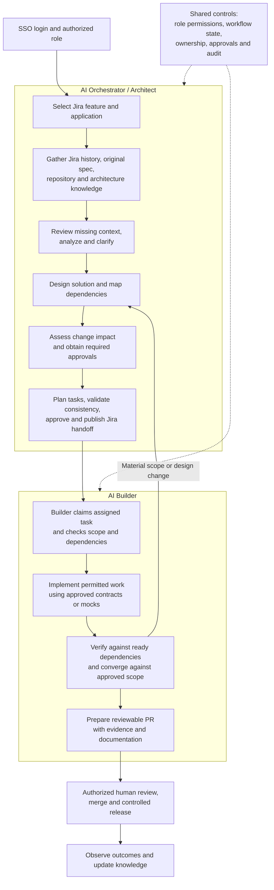

# O2A Task Flow — AI Orchestrator and AI Builder

Open this file in a Markdown viewer that supports Mermaid to render the diagrams. The detailed diagram source is also included as a standalone `.mmd` file.

## High-level workflow

The Builder can enter directly through an existing authorized assignment; the diagram above shows the end-to-end feature journey. Mock-based work may proceed in parallel, but real integration and completion require the applicable dependency readiness and verification evidence. Approvals are specific to their scope and do not grant new permissions.

## Detailed task flow

```mermaid
flowchart TD
    LOGIN["Company SSO login"] --> ROLE{"Select authorized persona"}
    ROLE -->|AI Orchestrator| FEATURE
    ROLE -->|AI Builder| CLAIM

    subgraph ORCH["AI Orchestrator / Architect"]
        FEATURE["Select assigned Jira feature"]
        FEATURE --> SCOPE["Resolve application and repository scope"]
        SCOPE --> CONTEXT["Retrieve related open/closed Jiras,<br/>original spec, repository knowledge,<br/>architecture, APIs, and database metadata"]
        CONTEXT --> COVERAGE["Show retrieved context<br/>Ask: Is anything missing?"]
        COVERAGE --> MISSING{"Additional sources needed?"}
        MISSING -->|Yes| RETRIEVE["Retrieve authorized sources<br/>Surface unavailable material"]
        RETRIEVE --> COVERAGE
        MISSING -->|Known coverage reviewed| ANALYZE["Analyze original intent, Jira history,<br/>architecture, and current code"]
        ANALYZE --> PRINCIPLES["Check approved project constitution"]
        PRINCIPLES --> SPEC["Normalize specification and scope"]
        SPEC --> QUESTIONS["Ask evidence-grounded clarifying questions"]
        QUESTIONS --> CLEAR{"Material questions resolved?"}
        CLEAR -->|No| QUESTIONS
        CLEAR -->|Yes| DESIGN["Draft technical design"]
        DESIGN --> IMPACT["Map dependencies and assess change impact"]
        IMPACT --> OWNERS["Collect required affected-owner decisions"]
        OWNERS --> APPROVAL{"Human Orchestrator approves<br/>the change baseline?"}
        APPROVAL -->|Revise| DESIGN
        APPROVAL -->|Approve| CHECKLIST["Review requirements/design quality checklist"]
        CHECKLIST --> TASKS["Plan delivery tasks<br/>Assign provider/consumer ownership<br/>Define contracts and readiness gates"]
        TASKS --> CONSISTENCY["Analyze specification, design,<br/>tasks, and dependency consistency"]
        CONSISTENCY --> CONSISTENT{"Material gaps resolved?"}
        CONSISTENT -->|No| TASKS
        CONSISTENT -->|Yes| PREVIEW["Preview exact Jira changes"]
        PREVIEW --> PUBLISH{"Approve Jira publication?"}
        PUBLISH -->|Revise| TASKS
        PUBLISH -->|Approve| CREATE["Create linked Jira tasks<br/>Publish versioned handoff"]
    end

    CREATE --> CLAIM
    subgraph BUILD["AI Builder"]
        CLAIM["Select and atomically claim assigned task"]
        CLAIM --> DEPENDENCIES["Check ownership, approved scope,<br/>contract versions, and dependency readiness"]
        DEPENDENCIES --> READY{"What work is permitted?"}
        READY -->|None| WAIT["Wait for dependency or owner decision"]
        WAIT --> DEPENDENCIES
        READY -->|Approved mock work| MOCK["Implement consumer against approved mock"]
        READY -->|Provider available| IMPLEMENT["Inspect baseline, plan,<br/>and implement assigned slice"]
        MOCK --> MOCKTEST["Run mock and contract checks"]
        MOCKTEST --> PROVIDER{"Compatible provider deployed?"}
        PROVIDER -->|No| WAITLIVE["Keep live integration blocked<br/>Do not declare task complete"]
        WAITLIVE --> PROVIDER
        PROVIDER -->|Yes| VERIFY
        IMPLEMENT --> VERIFY["Run applicable tests and quality checks"]
        VERIFY --> PASSED{"Required checks passed?"}
        PASSED -->|No| REPAIR["Repair within approved scope and budget"]
        REPAIR --> VERIFY
        PASSED -->|Yes| REVIEW["Independent verification"]
        REVIEW --> CONVERGE["Compare implementation and evidence<br/>against approved spec, design, and tasks"]
        CONVERGE --> GAPS{"Remaining gaps?"}
        GAPS -->|Within approved scope| REPAIR
        GAPS -->|New requirement or material impact| REASSESS["Return to Architect reassessment"]
        GAPS -->|No blocking gaps| PR["Prepare PR with tests, documentation,<br/>dependencies, and release instructions"]
    end

    REASSESS --> DESIGN
    PR --> HUMAN["Authorized human review"]
    HUMAN -->|Changes requested| REPAIR
    HUMAN -->|Accepted| RELEASE["Authorized merge and controlled release"]
    RELEASE --> OBSERVE["Verify deployed behavior<br/>Update knowledge and capture outcomes"]
    GUARD["All stages:<br/>Enforce role and resource permissions<br/>Keep unrelated chat outside task flow<br/>Show workflow step separately from discussion topic"]
    GUARD -.-> ORCH
    GUARD -.-> BUILD
```

**Parallel-work rule:** JIRA-12 owns the API; JIRA-34 consumes it. JIRA-34 may use an approved mock, but cannot create the provider API or complete live integration before the provider is ready.
